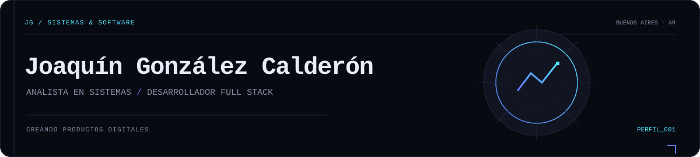
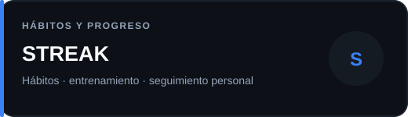
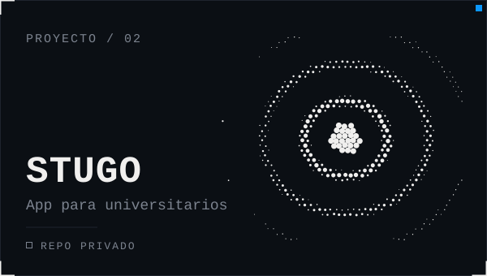
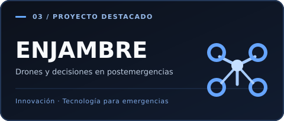
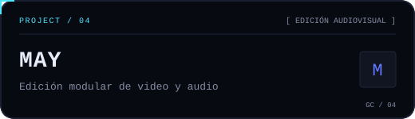
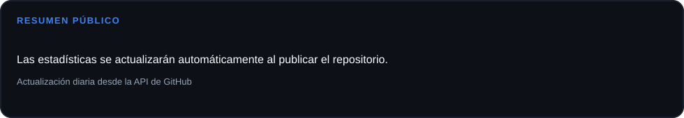
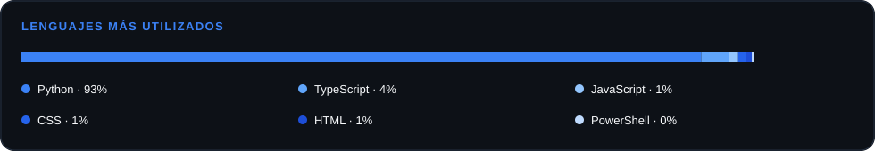
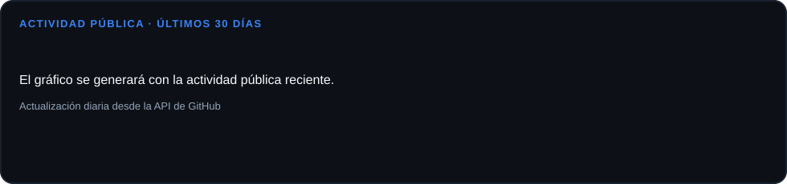

  

  <a href="https://www.joaquincalderon.com.ar/">PORTFOLIO</a>
  &nbsp;&nbsp;·&nbsp;&nbsp;
  <a href="https://www.instagram.com/joaquinncalderon/">INSTAGRAM</a>
  &nbsp;&nbsp;·&nbsp;&nbsp;
  <a href="https://github.com/JoaquinGonzalezCalderon">GITHUB</a>

## 01 — Perfil

Analista en Sistemas y desarrollador Full Stack. Diseño y construyo productos digitales, desde la idea hasta su implementación.

## 02 — Tecnologías

  

## 03 — Proyectos seleccionados

Seguimiento de hábitos, creatina, entrenamientos y progreso personal. [Abrir aplicación ↗](https://www.streak.com.ar/app)

Aplicación móvil en equipo para estudiantes universitarios: servicios, lugares, vivienda y viajes compartidos. Repositorio privado

Reconocimiento con drones para apoyar decisiones durante la respuesta a postemergencias.

Editor multimedia de video y audio todo en uno, con interfaz modular y herramientas para creadores.

## 04 — GitHub

Datos basados en repositorios y actividad públicos.

