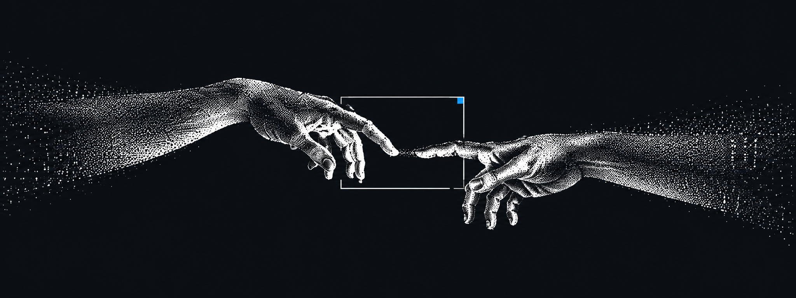
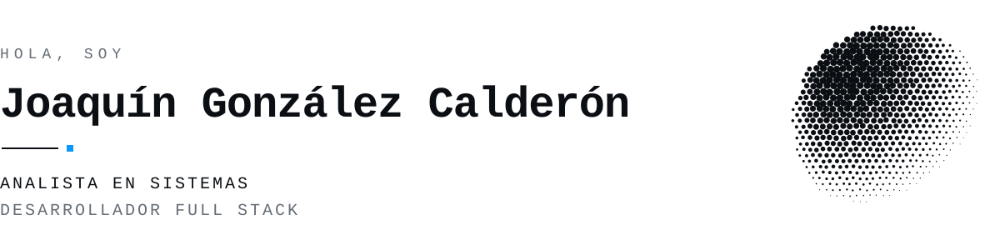
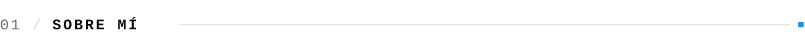
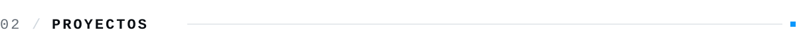
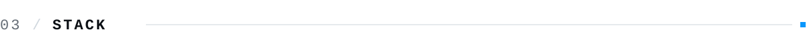
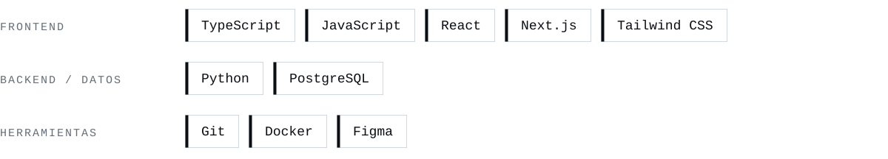
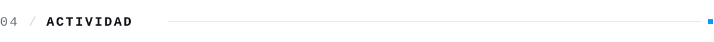
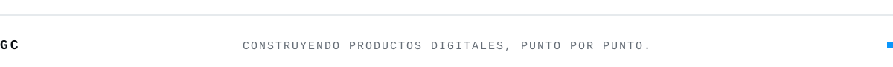

  

<picture>
  <source media="(prefers-color-scheme: dark)" srcset="assets/intro-dark.svg">
  
</picture>

Construyo productos digitales útiles, desde la idea hasta su implementación.

[Portfolio ↗](https://www.joaquincalderon.com.ar/) &nbsp;/&nbsp; [Instagram ↗](https://www.instagram.com/joaquinncalderon/)

 

<picture>
  <source media="(prefers-color-scheme: dark)" srcset="assets/section-about-dark.svg">
  
</picture>

Soy analista en sistemas y desarrollador full stack. Me interesa resolver problemas reales con software y crear experiencias claras, cuidadas y fáciles de usar.

Trabajo en aplicaciones web y móviles, conectando diseño, desarrollo y producto. Disfruto aprender herramientas nuevas y convertir ideas en soluciones que puedan crecer con el tiempo.

 

<picture>
  <source media="(prefers-color-scheme: dark)" srcset="assets/section-projects-dark.svg">
  
</picture>

  
  

  
  

 

<picture>
  <source media="(prefers-color-scheme: dark)" srcset="assets/section-stack-dark.svg">
  
</picture>

<picture>
  <source media="(prefers-color-scheme: dark)" srcset="assets/stack-dark.svg">
  
</picture>

 

<picture>
  <source media="(prefers-color-scheme: dark)" srcset="assets/section-activity-dark.svg">
  
</picture>

  
  

  

<picture>
  <source media="(prefers-color-scheme: dark)" srcset="assets/footer-dark.svg">
  
</picture>
